# Agora Virtual Estates

**Tour homes and offices in Bengaluru on a live voice call.** Shivam, an AI property advisor, talks
with the buyer and drives the screen as they speak: he walks them through the home in 3D, opens the
floor plan with wiring and plumbing, shows the neighbourhood and the commute, works out the price
with EMI, checks the legal papers and books the site visit. When the buyer wants a person, a human
advisor joins the same call with live AI notes, and the sales pipeline (WhatsApp, email, Slack,
Jira, HubSpot) runs on its own.

Built for the **Build with Agora** hackathon, Bengaluru, with Agora Conversational AI and Murf
Falcon.

**Live demo:** [agora-virtual-estates.vercel.app](https://agora-virtual-estates.vercel.app) ·
**Lead Desk:** [/desk](https://agora-virtual-estates.vercel.app/desk) ·
**Promo film:** [70 s video](video/out/agora-virtual-estates-promo.mp4)

[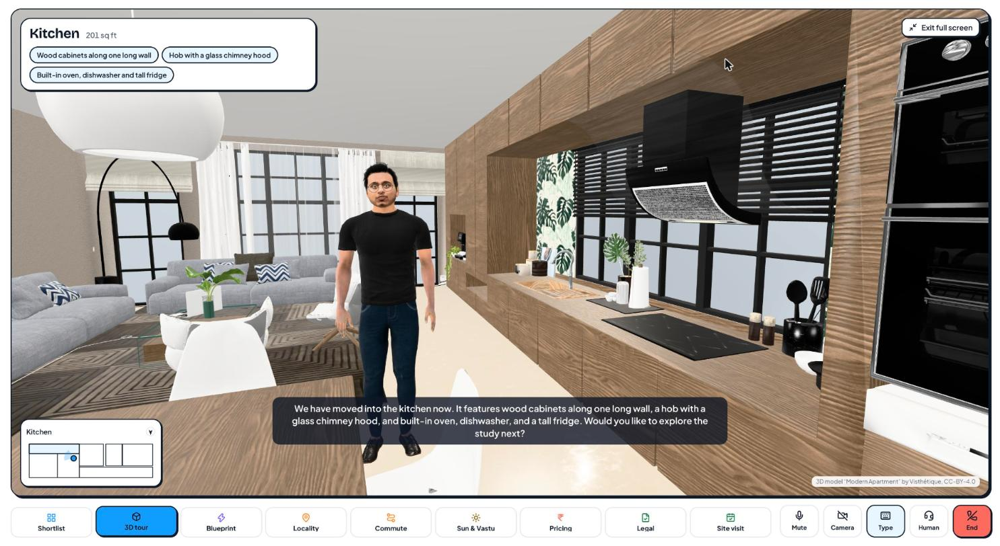](video/out/agora-virtual-estates-promo.mp4)

> The live API runs on Render's free plan and sleeps after 15 minutes idle. If the first call
> takes a while to connect, open the page again after a minute.

## Watch

▶ **[Promo film (70 s, 1080p)](video/out/agora-virtual-estates-promo.mp4):** a motion-graphics
walkthrough of the product, made in code with Remotion (`video/`). GitHub plays it in the file
view; download it for full quality.

## Screenshots

### The landing page

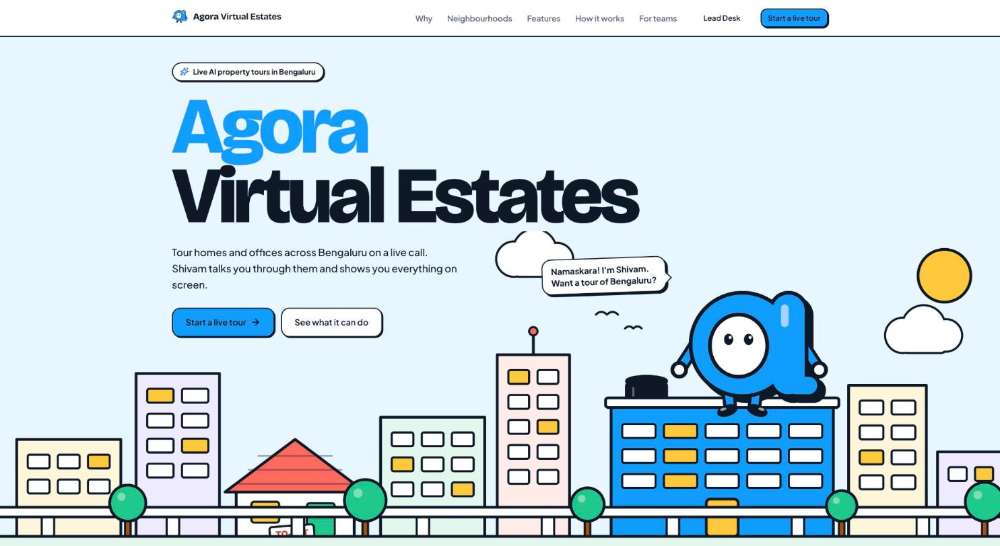

| Neighbourhoods | Everything on one call |
|---|---|
| 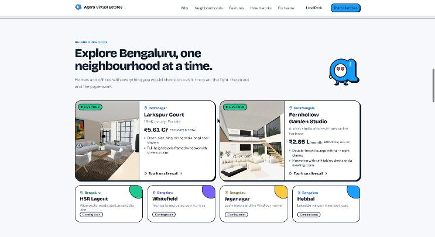 | 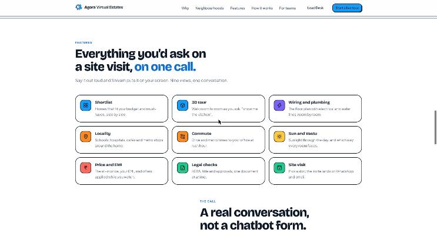 |

### The call

| Shivam calls the buyer | The shortlist |
|---|---|
| 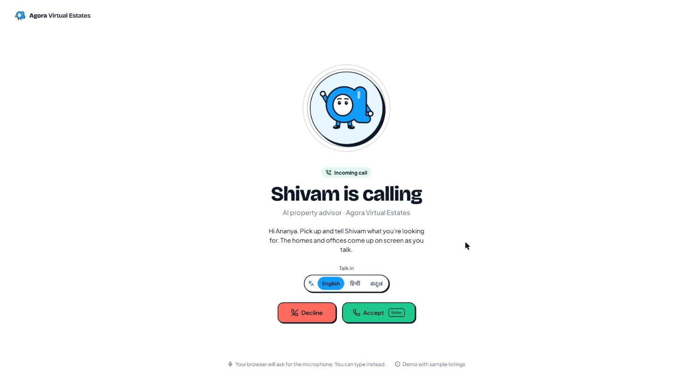 | 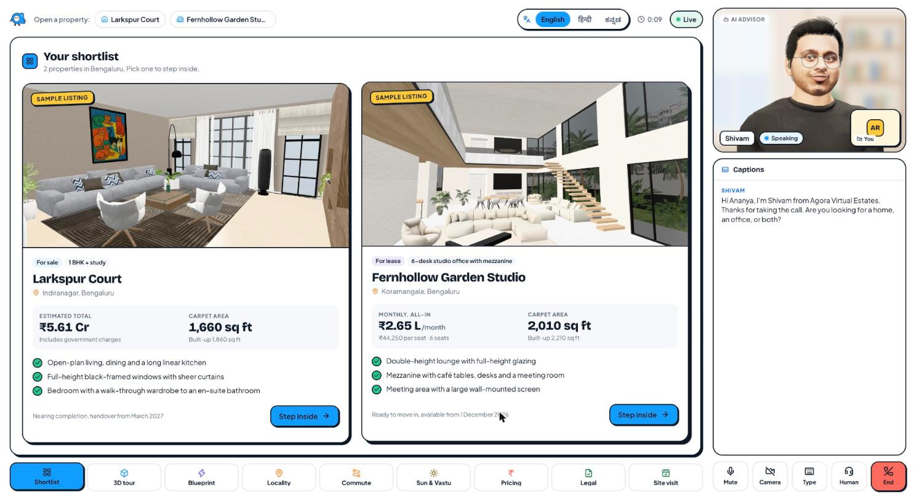 |

| 3D tour: Shivam walks the home with you | Dollhouse view of the whole flat |
|---|---|
| 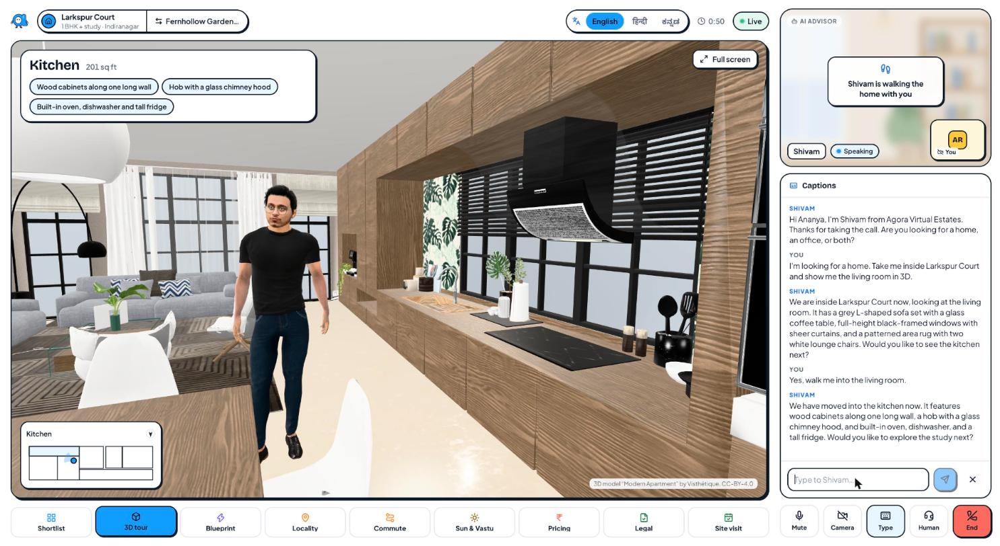 | 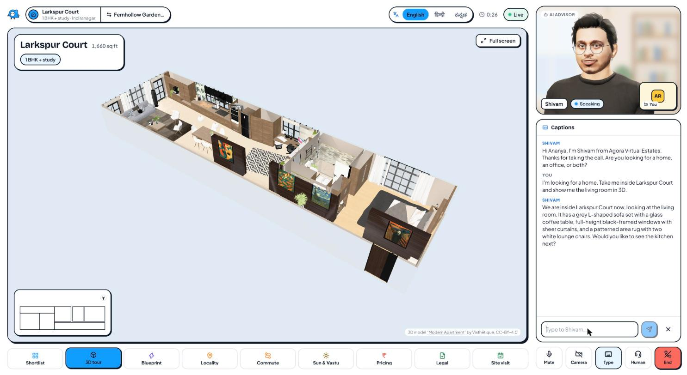 |

| Floor plan with plumbing and wiring | Price, charges and EMI |
|---|---|
| 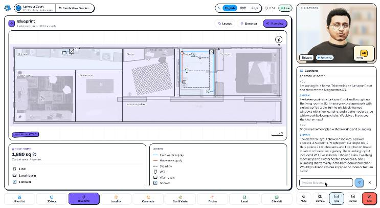 | 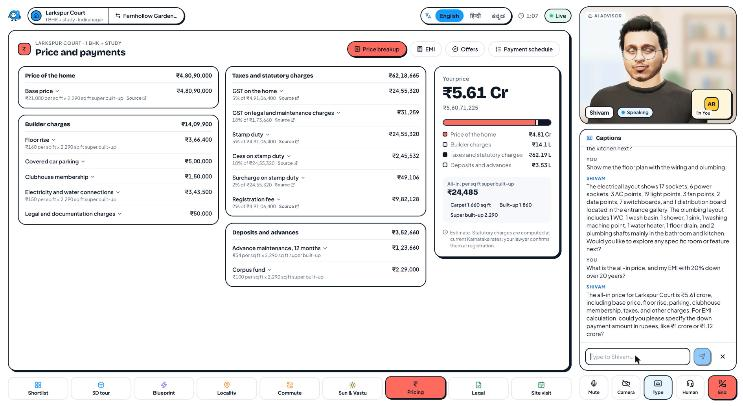 |

| The neighbourhood | |
|---|---|
| 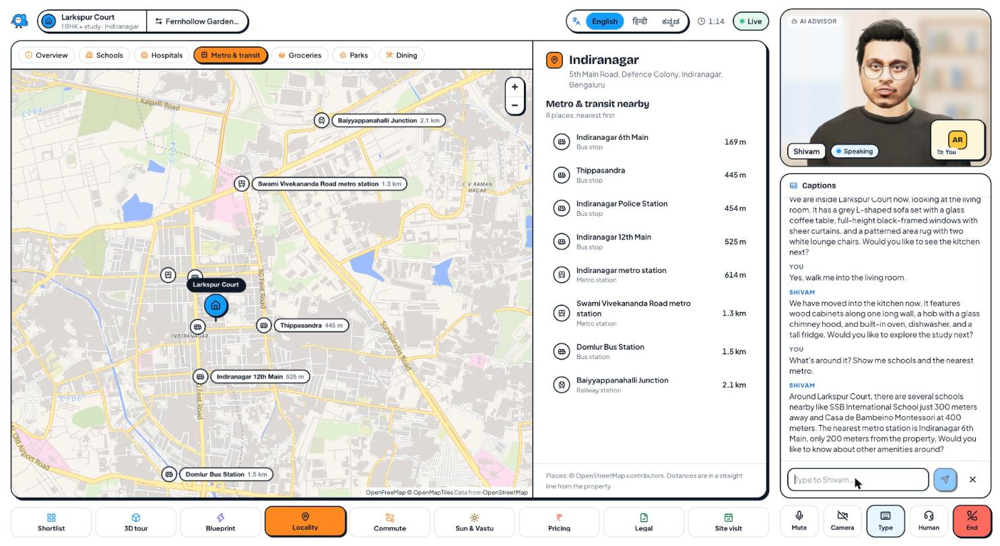 | Every view opens because the buyer asked for it out loud (or typed it). Captions run alongside in English, Hindi or Kannada. |

### The sales team's Lead Desk

| Lead detail with the WhatsApp recap preview | Pipeline board with every delivery |
|---|---|
| 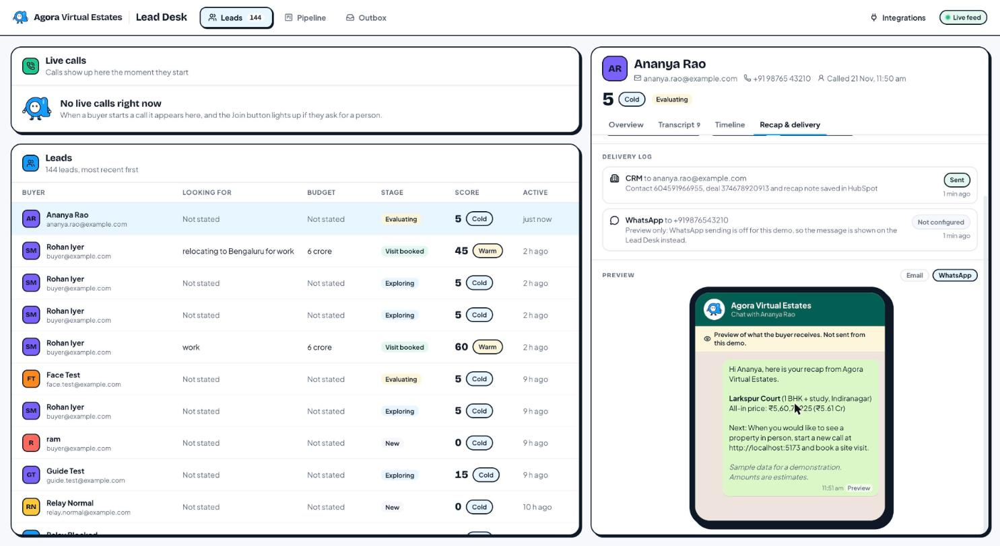 | 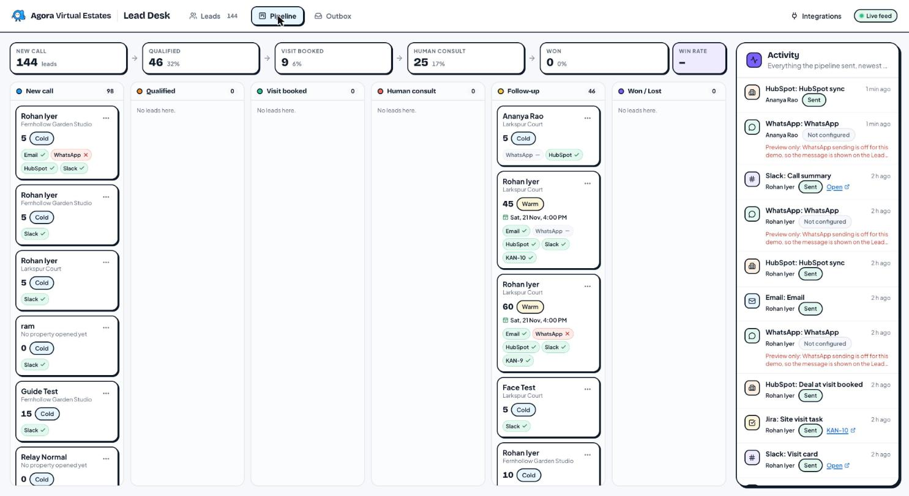 |

Screenshots use fictional buyers and sample listings.

## What it does

**For the buyer**
- A real voice conversation, not a chatbot form. Talk or type, interrupt any time, switch between
  English, Hindi and Kannada.
- Nine views the advisor opens on request: shortlist, 3D tour, blueprint (layout, electrical,
  plumbing), locality, commute, sun path and Vastu, pricing with EMI and offers, legal checks, and
  site-visit booking.
- A lip-synced 3D advisor who steps into the 3D tour and walks from room to room with the buyer,
  with a full-screen mode.
- A recap after the call, by email and WhatsApp.

**For the sales team**
- **Lead Desk** (`/desk`): every call live, lead scores, transcripts and a timeline.
- **Human handoff:** when the buyer asks for a person, the desk rings. The advisor joins the same
  Agora call, and Agora Real-Time STT feeds live consult notes: what the buyer asked, promises
  that need approval, objections and next steps. A copilot drafts the follow-up, and the advisor
  can send it on WhatsApp or email, raise a Jira task, post to Slack or open a view on the buyer's
  screen.
- **Pipeline automations:** visit cards and call summaries in Slack (one thread per lead), Jira
  tasks for site visits and promises, HubSpot contacts, deals and notes, and email and WhatsApp
  recaps. The **Integrations** page shows each connection and sends a test.

## How it works

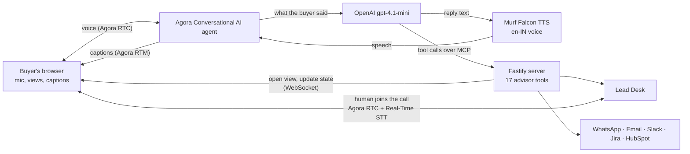

- **Agora Conversational AI** runs the voice agent: it listens on the call, handles turn-taking and
  interruptions, sends the buyer's words to the LLM and speaks the reply with Murf.
- **The advisor's 17 tools** (`showShortlist`, `tourGoTo`, `showBlueprint`, `showLocality`,
  `showMoney`, `bookSiteVisit`, `sendReport`, `requestHuman` and more) are served by the app's own
  MCP server, so the agent changes what the buyer sees while it talks.
- **Murf Falcon** gives Shivam an Indian English voice, with the locale switched to match the
  call's language.
- **Agora RTM** carries live captions; **Agora Real-Time STT** transcribes the human consult for
  the notes.

## Run it locally

You need Node 22.13 or newer and pnpm.

```bash
pnpm install
cp .env.example .env    # then fill in the keys you have
pnpm dev                # web on http://localhost:5173, API on http://localhost:8787
pnpm tunnel             # public URL so the Agora agent can reach the MCP tools
```

`.env.example` lists every setting with a short note. Agora, Murf and OpenAI keys are needed for
the voice call. Email, WhatsApp, Slack, Jira and HubSpot are optional; each shows as "Not
configured" until its keys are set. `WHATSAPP_PROVIDER=preview` shows the WhatsApp message on the
Lead Desk instead of sending it.

Checks: `pnpm typecheck` and `pnpm test`. `pnpm reset` clears saved test leads.

## Deploy

The web app runs on Vercel and the API on Render. Steps are in [docs/deploy.md](docs/deploy.md).

## Layout

| Folder | What it holds |
|---|---|
| `apps/web` | React, Vite and Tailwind front end: landing page, call screen, views, Lead Desk |
| `apps/server` | Fastify API: sessions, voice agent, MCP tools, integrations, Lead Desk |
| `packages/shared` | Shared types, schemas and calculations |
| `data` | Property content: rooms, tour stops, prices, legal papers, localities |
| `docs` | Build plan, integrations plan, deploy steps, voice runbook and screenshots |
| `video` | Remotion source for the promo film |

## Tech

React 19, Vite, Tailwind, three.js and react-three-fiber, TalkingHead with HeadAudio, MapLibre ·
Fastify, Node's built-in SQLite, Zod · Agora Conversational AI, RTC, RTM and Real-Time STT · Murf
Falcon · OpenAI · Resend, Twilio, Slack, Jira Cloud and HubSpot APIs · Remotion for the film.

## Credits

- 3D models: "Modern Apartment" by Visthétique and "Loft 18 mini office v.environment" by dasy444,
  from Sketchfab (credited in each property's `property.json` and shown in the tour).
- Fallback avatar: `mpfb.glb` from the TalkingHead project (CC0). The advisor avatar was made with
  Avaturn (free for non-commercial use).
- Maps: OpenFreeMap and OpenStreetMap contributors.
- Two sample properties, Larkspur Court (Indiranagar, for sale) and Fernhollow Garden Studio
  (Koramangala, office lease). Listings, prices and documents are fictional.
